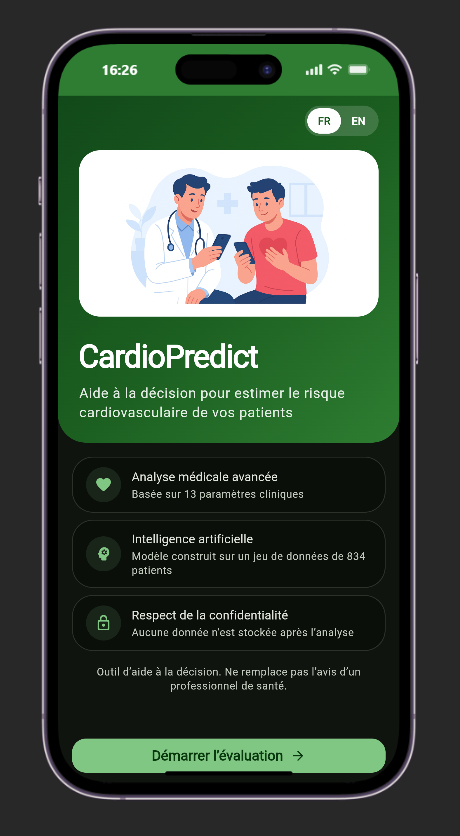
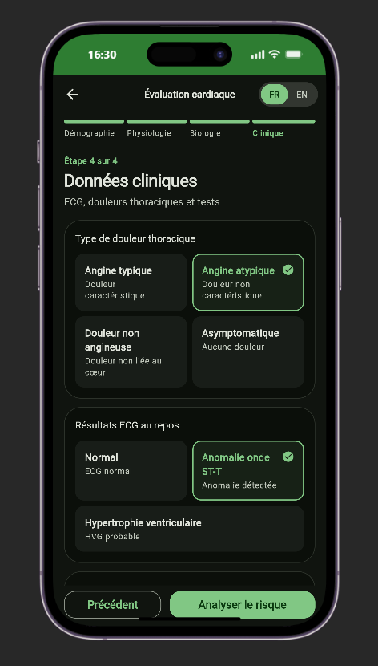
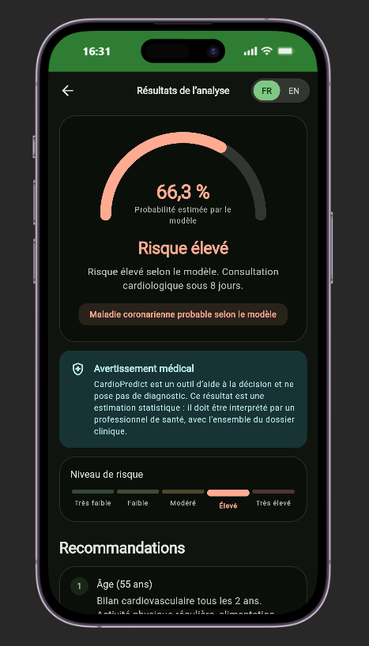
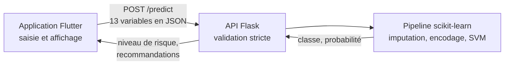

# CardioPredict — application mobile


**FR —** Application mobile qui aide les professionnels de santé à estimer le risque cardiovasculaire d'un patient. Le médecin saisit 13 paramètres cliniques ; un modèle d'apprentissage automatique, servi par une API Flask, renvoie une probabilité et un niveau de risque. Interface disponible en français et en anglais.

**EN —** Mobile app that helps healthcare professionals estimate a patient's cardiovascular risk. The clinician enters 13 clinical parameters; a machine learning model served by a Flask API returns a probability and a risk level. The interface is available in French and English.

> **Outil d'aide à la décision, pas un diagnostic.** Voir l'[avertissement médical](#11-avertissement-médical).

## 2. Contexte et objectif

Au Bénin, l'accès aux spécialistes et aux outils d'évaluation du risque cardiovasculaire reste inégal. CardioPredict vise à aider les professionnels de santé à **estimer rapidement ce risque** à partir de données cliniques, au moment de la consultation.

Ce dépôt contient l'application mobile réalisée pour le mémoire de Master en Génie Logiciel *« Développement d'un modèle d'intelligence artificielle pour la prédiction du risque cardiovasculaire et son intégration dans une application mobile »* (IFRI, Université d'Abomey-Calavi). Le modèle et l'API sont dans le dépôt [`cardio_predict_model`](https://github.com/Abdoul-wakilou/cardio_predict_model).

## 3. Fonctionnalités

- Formulaire en 4 étapes couvrant les 13 variables du modèle, avec contrôle de chaque saisie
- Résultat lisible : probabilité estimée, niveau de risque sur 5 échelons, recommandations
- Interface bilingue français / anglais, modifiable depuis chaque écran
- Thème clair et sombre (Material 3)
- Erreurs réseau expliquées, avec nouvel essai sans perdre la saisie
- Aucune donnée patient conservée sur le téléphone

## 4. Captures d'écran

Les images sont à déposer dans [`docs/screenshots/`](docs/screenshots/).

| Accueil | Formulaire | Résultat |
|---|---|---|
| `accueil.png` | `formulaire.png` | `resultat.png` |

<!-- Une fois les images ajoutées, remplacer la ligne ci-dessus par :
|  |  |  |
-->

## 5. Architecture



Le code sépare l'affichage (`screens/`, `widgets/`), la logique du formulaire (`controllers/`) et les appels réseau (`services/`). Le service de prédiction est défini par une interface, remplacée par un faux service dans les tests.

Une réponse incomplète ou incohérente de l'API provoque une erreur visible : elle ne peut jamais s'afficher comme un risque faible.

### Contrat avec l'API

| Champ | Type | Plage | Encodage |
|---|---|---|---|
| `age` | entier | 18 – 120 | années |
| `sex` | entier | 0 – 1 | 0 femme, 1 homme |
| `cp` | entier | 0 – 3 | 0 angine typique, 1 atypique, 2 non angineuse, 3 asymptomatique |
| `trestbps` | entier | 50 – 250 | mmHg |
| `chol` | entier | 50 – 700 | mg/dL |
| `fbs` | entier | 0 – 1 | glycémie à jeun > 120 mg/dL |
| `restecg` | entier | 0 – 2 | 0 normal, 1 anomalie ST-T, 2 hypertrophie ventriculaire |
| `thalach` | entier | 50 – 250 | bpm |
| `exang` | entier | 0 – 1 | angine d'effort |
| `oldpeak` | décimal | -5 – 10 | mm |
| `slope` | entier | 0 – 2 | 0 ascendante, 1 plate, 2 descendante |
| `ca` | entier | 0 – 3 | vaisseaux colorés en fluoroscopie |
| `thal` | entier | 0 – 2 | scintigraphie au thallium : 0 normal, 1 défaut fixe, 2 défaut réversible |

## 6. Technologies utilisées

| Domaine | Choix |
|---|---|
| Application | Flutter, Dart, Material 3 |
| Réseau | [`http`](https://pub.dev/packages/http) |
| Traductions | `flutter_localizations`, [`intl`](https://pub.dev/packages/intl) |
| Tests | `flutter_test`, `MockClient` |
| API et modèle (dépôt séparé) | Flask, scikit-learn |

L'application n'utilise aucun plugin natif et seulement deux paquets externes, tous deux publiés par l'équipe Dart.

## 7. Installation

### Prérequis

- Flutter 3.32 ou plus récent (développé et testé avec Flutter 3.47.9)
- Le SDK Android et un JDK 17 ou plus récent
- Un émulateur Android ou un téléphone
- L'API du dépôt [`cardio_predict_model`](https://github.com/Abdoul-wakilou/cardio_predict_model), installée selon son README, puis lancée pour l'émulateur avec `waitress-serve --listen=0.0.0.0:5000 api.app:app` (réseau de développement uniquement)

### Lancement en local

```bash
git clone https://github.com/Abdoul-wakilou/cardio_predict_mobile_app.git
cd cardio_predict_mobile_app
flutter pub get
flutter run
```

Sans configuration, un build de développement vise `http://10.0.2.2:5000`, adresse de la machine hôte vue depuis l'émulateur Android (`http://localhost:5000` sur le web).

Sur un téléphone relié en USB, rediriger le port :

```bash
adb reverse tcp:5000 tcp:5000
flutter run --dart-define=API_BASE_URL=http://localhost:5000
```

### Configuration de l'URL de l'API

L'URL n'est jamais écrite dans le code. Pour un build de production, copier l'exemple puis indiquer l'adresse HTTPS réelle :

```bash
cp dart_defines.example.json dart_defines.json   # fichier non commité
```

Un build de production refuse toute adresse qui n'est pas en HTTPS et affiche alors un message d'erreur.

### Génération de l'APK

```bash
flutter build apk --release --dart-define-from-file=dart_defines.json
```

Pour une diffusion, copier `android/key.properties.example` vers `android/key.properties` et renseigner la clé de signature. Sans ce fichier, l'APK est signé avec la clé de debug et ne convient qu'à une démonstration.

### Vérifications

```bash
flutter analyze
flutter test
```

## 8. Structure du projet

```text
lib/
  main.dart          point d'entrée
  app.dart           configuration de l'application, thème et langues
  config/            URL de l'API par environnement
  controllers/       état du formulaire, langue, accès aux services
  l10n/              textes français et anglais
  models/            patient et résultat
  screens/           accueil, à propos, formulaire, résultat
  services/          appel à l'API et erreurs réseau
  theme/             couleurs, espacements, thème Material 3
  utils/             champs cliniques, validation, libellés
  widgets/           composants réutilisables
test/                validation, conversion, réponses de l'API, parcours complets
```

## 9. Sécurité et confidentialité des données

| Mesure | Mise en œuvre |
|---|---|
| Aucun secret dans l'application | URL fournie à la compilation, fichiers locaux exclus du dépôt |
| HTTPS en production | Trafic en clair refusé sur Android et iOS, sauf adresses locales de développement |
| Données de santé | Conservées en mémoire le temps de l'écran ; rien n'est écrit sur le téléphone |
| Journaux | Aucune donnée patient journalisée ; les erreurs ne recopient pas les réponses du serveur |
| Permissions | Android : Internet uniquement |
| Historique Git | Analysé avec `gitleaks` : aucun secret détecté |

Les contrôles du formulaire servent le confort du médecin. **La vraie validation doit rester côté serveur**, car une application mobile peut être contournée. Aucune information d'identité (nom, numéro de dossier) n'est demandée.

La validation stricte et la limitation du débit sont assurées par l'API. Son déploiement public reste à réaliser derrière un proxy HTTPS.

## 10. Limites et perspectives

### Performances du modèle : une correction à connaître

Le mémoire rapporte des performances **surestimées**, comme l'a établi une revue postérieure à la soutenance. La variable `ca`, absente pour 62,9 % des patients, était imputée par la médiane *de la classe à prédire* avant le découpage : pour ces patients, elle révélait le diagnostic. Les valeurs `chol = 0`, qui codent une mesure absente, renseignaient aussi le modèle sur le centre d'origine.

Le dépôt du modèle corrige ces défauts. Évaluation sur les mêmes 251 patients de test :

| Modèle | Accuracy | AUC | Sensibilité | Spécificité |
|---|---:|---:|---:|---:|
| Mémoire, Random Forest (avec fuite) | 92,83 % | 0,980 | 94,96 % | 90,18 % |
| Corrigé, Random Forest | 78,49 % | 0,869 | 84,17 % | 71,43 % |
| **Corrigé, SVM (modèle servi par l'API)** | **76,49 %** | **0,844** | **82,01 %** | **69,64 %** |

**Seules les lignes corrigées sont à retenir.** Méthode, intervalles de confiance et validation par centre sont détaillés dans le [README du modèle](https://github.com/Abdoul-wakilou/cardio_predict_model#écart-avec-le-mémoire).

### Autres limites

- **Ce qui est prédit :** la présence d'une sténose coronarienne d'au moins 50 % à l'examen, et non la survenue future d'un événement cardiovasculaire.
- **Population :** données UCI de quatre centres (États-Unis, Hongrie, Suisse), anciennes, à 78 % masculines et sans patient béninois. Le modèle n'a pas été validé localement.
- **Examens requis :** la fluoroscopie (`ca`), la scintigraphie au thallium (`thal`) et l'épreuve d'effort ne sont pas toujours disponibles.
- **Niveaux et recommandations :** ils viennent de règles écrites dans l'API, en français uniquement pour les recommandations, et n'ont pas été validés par des cardiologues.
- **Transfert :** les performances chutent fortement entre centres (AUC de 0,655 à Long Beach VA quand ce centre est exclu de l'entraînement).

### Perspectives

- Valider le modèle sur des données béninoises
- Proposer un mode sans examens invasifs
- Traduire les recommandations côté API
- Évaluer l'outil avec des professionnels de santé

## 11. Avertissement médical

CardioPredict est un outil d'aide à la décision issu d'un travail universitaire. **Il ne pose pas de diagnostic et ne remplace pas le jugement d'un professionnel de santé.** Il n'a fait l'objet d'aucune certification comme dispositif médical ni d'aucune validation clinique. Ses résultats sont des estimations statistiques, à interpréter avec l'ensemble du dossier du patient.

## 12. Auteur

**Abdoul-Wakilou TIGA**

- E-mail : [abdoulwakiloutiga@gmail.com](mailto:abdoulwakiloutiga@gmail.com)
- GitHub : [github.com/Abdoul-wakilou](https://github.com/Abdoul-wakilou)
- LinkedIn : [linkedin.com/in/abdoul-wakilou-tiga](https://linkedin.com/in/abdoul-wakilou-tiga)
- Kaggle : [kaggle.com/abdoulwakiloutiga](https://kaggle.com/abdoulwakiloutiga)
- Site : [abdevfreelance.com](https://abdevfreelance.com)

**Mémoire :** *Développement d'un modèle d'intelligence artificielle pour la prédiction du risque cardiovasculaire et son intégration dans une application mobile*, Master en Génie Logiciel, IFRI, Université d'Abomey-Calavi. Soutenu le 29 juillet 2026, mention Bien. Encadrant : Dr (MA) Mêton Mêton Atindehou.

Le mémoire est disponible sur demande auprès de l'auteur.

**Modèle et API :** [`cardio_predict_model`](https://github.com/Abdoul-wakilou/cardio_predict_model)

## 13. Licence

Distribué sous licence MIT. Voir le fichier [LICENSE](LICENSE).
